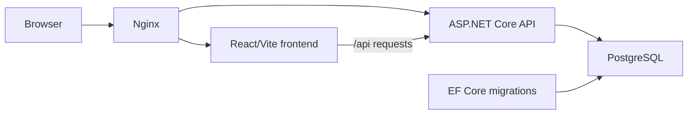

# MediTrack

MediTrack is a medication and daily health-tracking application. Patients can manage medicines, record medication status and wellness details, review adherence history, and view statistics. Doctors can manage their patient list, review patient adherence information, and prescribe medicines to patients assigned to them.

The repository contains a React single-page application, an ASP.NET Core Web API, a PostgreSQL database, and an optional Nginx reverse proxy.

## Features

- Patient registration and login with JWT bearer authentication.
- Secure password hashing with BCrypt.
- Medicine management, including dosage, frequency, time of day, and active state.
- Daily medication logs with taken, missed, or skipped status.
- Optional mood, symptoms, and notes for daily logs.
- Medication history and adherence statistics.
- Doctor dashboard with patient search and patient adherence summaries.
- Doctor-patient assignment and removal.
- Doctor prescribing for assigned patients.
- EF Core database migrations for PostgreSQL.
- Swagger/OpenAPI in the ASP.NET Core Development environment.
- Docker Compose orchestration for PostgreSQL, migrations, API, frontend, and Nginx.

## Technology stack

| Area | Technology |
| --- | --- |
| Frontend | React 19, React Router 7, Axios |
| Frontend tooling | Vite 8, Tailwind CSS 4, Oxlint |
| Backend | ASP.NET Core Web API on .NET 8 |
| Data access | Entity Framework Core 8 |
| Database | PostgreSQL 16 |
| Authentication | JWT bearer tokens and BCrypt.Net-Next |
| API documentation | Swashbuckle ASP.NET Core |
| Reverse proxy | Nginx 1.27 Alpine |
| Containerization | Docker and Docker Compose |

## Architecture

The frontend calls the API under `/api`. In the Compose setup, Nginx exposes the application on port 80, routes `/api/` to the API container, and routes all other paths to the Vite frontend. The API uses EF Core and Npgsql to access PostgreSQL.



The API is organized around controllers, services, entities, DTOs, and EF Core configuration:

- Controllers expose authentication, medicine, daily log, and doctor endpoints.
- Services contain application and authorization-related business logic.
- `AppDbContext` and the configuration classes map entities to PostgreSQL.
- JWT claims include the user ID, email, name, and role.
- The frontend stores the JWT in browser `localStorage` and sends it as a bearer token.

## Repository structure

```text
.
├── backend/
│   └── MediTrack.API/
│       ├── Controllers/       # HTTP API endpoints
│       ├── Data/              # DbContext and EF Core entity configuration
│       ├── Helpers/           # JWT token generation
│       ├── Middleware/        # Exception handling middleware
│       ├── Migrations/        # EF Core PostgreSQL migrations
│       ├── Models/            # Entities, DTOs, and enums
│       ├── Services/          # Business logic and service interfaces
│       ├── Dockerfile         # API and migration container build
│       ├── Program.cs         # Dependency injection and middleware pipeline
│       └── appsettings*.json  # ASP.NET Core configuration defaults
├── frontend/
│   └── meditrack-ui/
│       ├── src/
│       │   ├── components/    # Reusable UI components
│       │   ├── context/       # Authentication context
│       │   ├── pages/         # Patient and doctor screens
│       │   └── services/      # Axios API client
│       ├── Dockerfile
│       ├── package.json
│       └── vite.config.js
├── nginx/
│   └── nginx.conf             # Reverse-proxy routes and security headers
├── .env.example               # Environment variable template
└── docker-compose.yml         # Local multi-container development stack
```

Generated build output, installed dependencies, and container volumes are not part of the application source and are not required to be recreated manually.

## Prerequisites

For local development without Docker:

- .NET SDK 8
- Node.js 20 or later and npm
- PostgreSQL compatible with the PostgreSQL 16 schema

For the containerized setup:

- Docker Engine
- Docker Compose v2 (`docker compose`)

## Configuration

Copy the environment template before starting the application:

```bash
cp .env.example .env
```

`.env` is intentionally not documented with real credentials. Replace all placeholder values, especially the JWT key and PostgreSQL password, before using the application outside a local development environment.

The supported variables are:

| Variable | Purpose |
| --- | --- |
| `ASPNETCORE_ENVIRONMENT` | ASP.NET Core environment. `Development` enables Swagger UI. |
| `ConnectionStrings__DefaultConnection` | PostgreSQL connection string used by the API and EF Core. |
| `Jwt__Key` | JWT signing key. Use a secret of at least 32 characters. |
| `Jwt__Issuer` | JWT issuer value. |
| `Jwt__Audience` | JWT audience value. |
| `Jwt__ExpiryInDays` | JWT lifetime in days. |
| `POSTGRES_DB` | PostgreSQL database name for Compose. |
| `POSTGRES_USER` | PostgreSQL user for Compose. |
| `POSTGRES_PASSWORD` | PostgreSQL password for Compose. |
| `VITE_API_URL` | Frontend API base URL. The Compose and Nginx setup uses `/api`. |

Both `Program.cs` and `vite.config.js` load the repository-level `.env` for local development. Do not commit `.env` or place secrets in frontend source code.

## Run with Docker Compose

This is the supported end-to-end setup and runs migrations before starting the API:

```bash
cp .env.example .env
# Edit .env and replace placeholder secrets/passwords.
docker compose up --build
```

Open the application at <http://localhost>. The individual services are also available at:

- Frontend: <http://localhost:5173>
- API: <http://localhost:8080>
- PostgreSQL: `localhost:5433`

The `migrations` service runs `dotnet ef database update` and must complete successfully before the API starts. PostgreSQL data is persisted in the `meditrack-postgres-data` named volume.

To stop the stack:

```bash
docker compose down
```

To stop it and remove the persisted database volume:

```bash
docker compose down -v
```

The second command deletes the local Compose database data.

## Run locally without Docker

### Database and API

1. Start PostgreSQL and create a database, user, and password.
2. Copy `.env.example` to `.env`.
3. Set `ConnectionStrings__DefaultConnection` in `.env` to a connection string reachable from the host. For a PostgreSQL server on the default local port, the host is typically `localhost`, not the Compose service name `postgres`.
4. Set a non-placeholder `Jwt__Key`.
5. Apply the existing migrations and start the API:

```bash
cd backend/MediTrack.API
dotnet tool install --global dotnet-ef --version 8.*
dotnet ef database update
dotnet run
```

The default Development launch profile serves the API at <http://localhost:5166> and exposes Swagger UI at <http://localhost:5166/swagger>. The API can also be started with:

```bash
ASPNETCORE_ENVIRONMENT=Development dotnet run --launch-profile http
```

### Frontend

In a second terminal:

```bash
cd frontend/meditrack-ui
npm ci
npm run dev
```

The Vite development server runs at <http://localhost:5173>. `vite.config.js` proxies `/api` requests to `http://localhost:5166` by default. To use another API address, set `VITE_API_PROXY_TARGET` when starting Vite:

```bash
VITE_API_PROXY_TARGET=http://localhost:8080 npm run dev
```

For a production frontend bundle:

```bash
npm run build
npm run preview
```

The repository does not include a separate production frontend server command; the Compose stack currently runs Vite in development mode behind Nginx.

To publish and run the API outside the development server:

```bash
cd backend/MediTrack.API
dotnet publish --configuration Release --output ./publish
dotnet ./publish/MediTrack.API.dll
```

Configure the required connection string and JWT settings in the environment used by the published process. Database migrations are not applied automatically by the published API; run `dotnet ef database update` separately before starting it.

## Database and migrations

The API uses PostgreSQL through `Npgsql.EntityFrameworkCore.PostgreSQL`. The checked-in migration history currently includes:

- `InitialCreate`
- `AddRolesAndPhone`
- `AddDoctorPatientRelationship`
- `AddPrescribedByDoctorId`

To apply pending migrations locally:

```bash
cd backend/MediTrack.API
dotnet ef database update
```

To create a new migration after changing the entity model:

```bash
dotnet ef migrations add DescriptiveMigrationName
dotnet ef database update
```

The Docker Compose workflow applies migrations with the dedicated `migrations` service. There is no separate seed-data or admin-user initialization script in the repository. Public registration creates Patient users; existing user roles must be managed through the database or another administrative process.

## Creating a Doctor Account

Registration always creates a Patient account. Start the Docker services, register the account through the API, then promote the account to Doctor in PostgreSQL.

### Docker setup

```bash
# Register via API first
curl -X POST http://localhost:8080/api/auth/register \
  -H "Content-Type: application/json" \
  -d '{"email":"doctor@example.com","password":"YourPassword","name":"Dr. Name"}'

# Promote the account to Doctor inside the PostgreSQL container
docker compose exec postgres psql \
  -U meditrack \
  -d meditrack \
  -c "UPDATE users SET \"Role\" = 1 WHERE \"Email\" = 'doctor@example.com';"
```

The account can then log in through the frontend at http://localhost:5173.

## API reference

The API base path is `/api`. Protected endpoints require:

```http
Authorization: Bearer <jwt-token>
```

### Authentication

| Method | Endpoint | Authentication | Description |
| --- | --- | --- | --- |
| `POST` | `/api/auth/register` | Public | Registers a Patient and returns a token plus user data. |
| `POST` | `/api/auth/login` | Public | Authenticates a user and returns a token plus user data. |
| `GET` | `/api/auth/me` | Bearer token | Returns the current user. |

Example registration:

```bash
curl -X POST http://localhost:5166/api/auth/register \
  -H 'Content-Type: application/json' \
  -d '{"name":"Alex Patient","email":"alex@example.com","password":"change-me","phone":"+1 555 0100"}'
```

The authentication response has this shape:

```json
{
  "token": "<jwt-token>",
  "user": {
    "id": "00000000-0000-0000-0000-000000000000",
    "name": "Alex Patient",
    "email": "alex@example.com",
    "phone": "+1 555 0100",
    "role": "Patient",
    "createdAt": "2026-01-01T00:00:00Z"
  }
}
```

### Medicines

All medicine endpoints require a bearer token. A medicine has `name`, `dosage`, `frequency`, and optional `timeOfDay`. `frequency` is serialized as an enum string by the API: `OnceDaily`, `TwiceDaily`, `ThreeTimesDaily`, or `Weekly`.

| Method | Endpoint | Required role | Description |
| --- | --- | --- | --- |
| `GET` | `/api/medicines` | Any authenticated user | Lists the current user's medicines. |
| `GET` | `/api/medicines/{id}` | Any authenticated user | Gets one medicine. |
| `POST` | `/api/medicines` | Doctor or Admin | Creates a medicine for the authenticated user. |
| `PUT` | `/api/medicines/{id}` | Doctor or Admin | Updates a medicine. |
| `DELETE` | `/api/medicines/{id}` | Doctor or Admin | Deactivates a medicine. |
| `POST` | `/api/patients/{patientId}/medicines` | Doctor | Prescribes a medicine to an assigned patient. |

Example request body:

```json
{
  "name": "Example Medicine",
  "dosage": "10 mg",
  "frequency": "OnceDaily",
  "timeOfDay": "08:00"
}
```

### Daily logs and statistics

| Method | Endpoint | Description |
| --- | --- | --- |
| `POST` | `/api/logs` | Creates or records a daily medicine log. |
| `GET` | `/api/logs?date=2026-01-01` | Gets the authenticated user's logs for a date. |
| `GET` | `/api/logs/history?days=30` | Gets log history; `days` defaults to 30. |
| `GET` | `/api/logs/stats` | Returns medicine count, log count, adherence, streak, and status breakdowns. |

Example log request:

```json
{
  "medicineId": "00000000-0000-0000-0000-000000000000",
  "date": "2026-01-01",
  "status": "Taken",
  "mood": 4,
  "symptoms": null,
  "notes": "Taken with breakfast"
}
```

`status` is one of `Taken`, `Missed`, or `Skipped`; `mood`, when supplied, must be between 1 and 5.

### Doctor endpoints

Every doctor endpoint requires a bearer token whose role is `Doctor`.

| Method | Endpoint | Description |
| --- | --- | --- |
| `GET` | `/api/doctor/dashboard` | Returns assigned-patient adherence and missed-medication summaries. |
| `GET` | `/api/doctor/patients` | Lists the doctor's assigned patients. |
| `GET` | `/api/doctor/patients/search?q=alex` | Searches patients. `q` must contain 1–100 non-whitespace characters. |
| `POST` | `/api/doctor/patients/{patientId}` | Assigns a patient to the doctor. |
| `DELETE` | `/api/doctor/patients/{patientId}` | Removes a patient assignment. |

Swagger UI is enabled only when `ASPNETCORE_ENVIRONMENT=Development`. It is not enabled by the production Compose environment unless that variable is changed.


## Authentication and authorization

- Passwords are stored as BCrypt hashes; plaintext passwords are not persisted.
- Login and registration return JWT bearer tokens.
- The frontend stores the token in `localStorage` and attaches it to API requests.
- Patient routes are protected in the frontend by `ProtectedRoute`.
- Doctor routes are protected in the frontend by `RoleProtectedRoute` and on the API with `[Authorize(Roles = "Doctor")]`.
- Public registration always assigns the `Patient` role. The API also defines `Doctor` and `Admin` roles for authorization.
- A `401` API response causes the frontend to clear its stored session and redirect to `/login`.

## Testing and quality checks

No backend test project or frontend test script is currently tracked in the repository. The available frontend checks are:

```bash
cd frontend/meditrack-ui
npm run lint
npm run build
```

The backend can be compiled with:

```bash
cd backend/MediTrack.API
dotnet build
```

## Troubleshooting

### The API cannot connect to PostgreSQL

- In Docker Compose, use the service hostname `postgres` and container port `5432` in `ConnectionStrings__DefaultConnection`; the host-mapped port is `5433`.
- For a host-run API, use a PostgreSQL hostname reachable from the host, commonly `localhost`, and the host's PostgreSQL port.
- Confirm that `POSTGRES_DB`, `POSTGRES_USER`, and `POSTGRES_PASSWORD` match the connection string used by the API.
- Check service status with `docker compose ps` and logs with `docker compose logs postgres migrations api`.

### The API starts before the schema exists

Use the Compose workflow so the `migrations` service applies the checked-in migrations before the API starts:

```bash
docker compose up --build
```

For a host-run API, run `dotnet ef database update` from `backend/MediTrack.API`.

### The frontend cannot reach the API

- Confirm the API is listening on the port configured by the Vite proxy.
- Host development defaults to `http://localhost:5166`.
- Compose sets the frontend container's proxy target to `http://api:8080`.
- When using the full Compose stack, browse through <http://localhost> so Nginx can route both frontend and API requests.

### Swagger is not available

Swagger is registered only in the Development environment. Start the API with `ASPNETCORE_ENVIRONMENT=Development` or use the `http` launch profile.

## Contributing

No repository-specific contribution workflow or code of conduct is currently documented. When making changes, preserve the existing frontend/backend separation, add or update EF Core migrations for model changes, and run the applicable lint, build, and migration checks before opening a change.

## License

No license file or license declaration is currently present in the repository.
